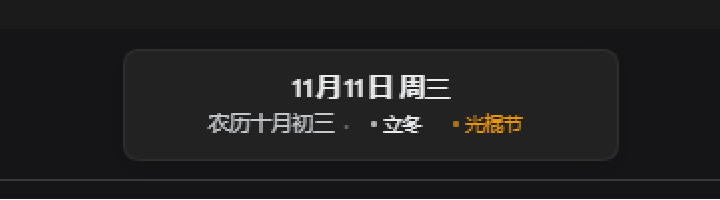

# 日历（Calendar Widget）

在工作区头部居中显示当前日期、农历、节气与节日；鼠标悬浮或点击节气/节日，弹出含义说明。



## 功能

- **日期**：横向显示公历月日与星期，例如 `11月11日 周三`。
- **农历**：农历月份与日期，例如 `农历十月初三`。
- **节气**：当前所处节气，以及下一个节气的日期倒计时。
- **节日**：今日节日；今日无节日时显示最近的 upcoming 节日及天数。
- **释义卡片**：悬浮或点击 `立冬`、`光棍节` 等标签，显示节气/节日名称、日期、类型和详细说明；点击可固定卡片，点击外部或按 `Esc` 关闭。
- **主题**：使用 DSH 主题变量，自动适配明暗主题。
- **自动刷新**：跨过午夜自动更新日期、农历、节气与节日。

## 位置与交互

- 在 `conversation.header.leading` 插槽内放一个零尺寸锚点，用 `createPortal` 把卡片挂到 `document.body`，避免标题栏 `overflow` 裁切。
- 以会话标签栏所在的整行容器计算水平中心，卡片在头部居中；垂直方向放在标签栏上方，不覆盖聊天正文。
- 卡片宽 `248px`、高 `56px`，`opacity: .94`，带主题背景与边框；标签本身可点击、可聚焦，卡片层级高于正文。
- 卡片本身 `pointer-events: none`，只有标签恢复 `pointer-events: auto`，不会挡住头部其它按钮。

## 文件

```
package.json        插件清单与 DSH bundle/client 配置
index.js            Host 端入口（无副作用）
client.js           客户端 UI、农历/节气/节日计算与释义数据
cordis.patch.yml    将插件插入 DSH bundle
locale/zh.json      中文元数据
locale/en.json      英文元数据
icon.svg            插件图标
preview.png         运行效果截图
```

## 安装 / 更新

在 DSH 中执行 `plugin_manager` 的 `install_bundle`，目标为：

```
D:\git\dsh-calendar-plugin
```

安装后插件会以 `link:` 方式链接到当前 profile。修改 `client.js` 后，在 `plugin_manager` 中对 `include:calendar-widget` 执行一次 disable/enable 即可热重载客户端，无需重启 Web GUI。

## 数据说明

- 农历由浏览器 `Intl.DateTimeFormat('zh-CN-u-ca-chinese')` 计算，闰月中的农历节日会被跳过。
- 节气使用经典的 24 节气分钟偏移公式计算（1900–2100 年范围），日期按本地时区。
- 节日库包含 34 个公历/农历/节气/第 n 个星期几规则，例如清明、除夕、中秋、母亲节、感恩节等。
- 节气与节日的说明为中文长文本；`清明节` 的说明按需求原文收录（去掉引用标记）。
